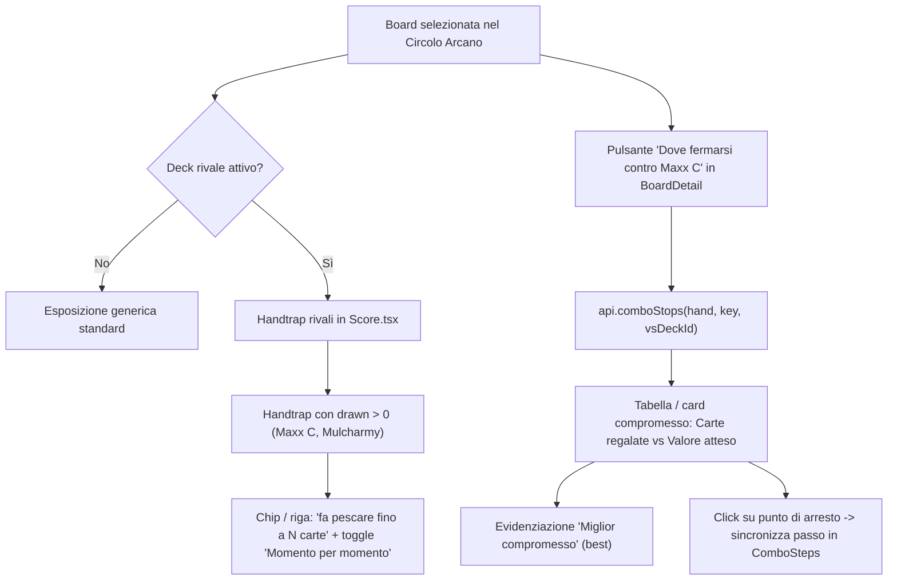

# Maxx "C" e Mulcharmy nel Circolo Arcano: Piano Interfaccia

*Data: 21/10/2026 — Agente: Gemini*
*Riferimenti: `docs/plans/turno-di-prova-matchup.md`, `docs/TASKS.md`*

## Obiettivo
Arricchire il Circolo Arcano quando è attivo il turno di prova contro un deck salvato della Bottega (`matchup`):
1. **Carte fatte pescare (`drawn` e `moments`)**: nella sezione delle handtrap avversarie di `Score.tsx`, per le carte che fanno pescare (Maxx "C", Mulcharmy Fuwalos, Mulcharmy Purulia, ecc. dove `drawn > 0`), mostrare «fa pescare fino a N carte» e il dettaglio dei momenti di gioco (`moments`: carta in gioco, fermata, carte pescate).
2. **Dove fermarsi contro pesca (`comboStops`)**: nella scheda della board (`BoardDetail.tsx`), inserire il pulsante «Dove fermarsi contro Maxx "C"» (o «Dove fermarsi sotto pesca»). Cliccando si invoca `api.comboStops(board.hand, board.key, vsDeckId)`. Il risultato mostra i punti di arresto della linea (passi giocati, carta in gioco, valore board, carte pescate, valore atteso nel turno avversario) con evidenziazione del migliore compromesso (`best`), avviso per i breaker standard se applicabile, e link interattivo per sincronizzare il visualizzatore passo-passo al passo corrispondente.
3. **Backend finto (`mock.ts`)**: arricchire `ComboRivalHandTrap` di Maxx "C" e Mulcharmy Fuwalos con `drawn` e `moments` realistici.

## Dettaglio Implementazione

### 1. `apps/desktop/src/components/combo/Score.tsx`
- In `RivalHandTrapRow`:
  - Se `h.drawn != null && h.drawn > 0`, visualizzare badge / testo: `fa pescare fino a ${h.drawn} carte`.
  - Se `h.moments && h.moments.length > 0`, inserire un `
` o un toggle compatto «Vedi momenti (N)»:
    - Elenco dei momenti con: carta giocata (`playing ? getCard(playing)?.name : "—"`), carte pescate cumulative (`drawn`), se la giocata ha fermato o alterato la board (`stops`).
- Nel riepilogo delle handtrap con `stops === 0`:
  - Per ciascuna chip con `h.drawn > 0`, mostrare il numero di carte pescate (es. `Maxx "C" (45% · fino a 9 carte)`).

### 2. `apps/desktop/src/components/combo/BoardDetail.tsx` (e `StopTradeOff.tsx`)
- Aggiungere il componente `StopTradeOff`:
  - Riceve `board: ComboBoard`, `matchup: ComboMatchup`, `getCard`, `onSelectStep?: (stepNumber: number) => void`.
  - Mostra il pulsante d'azione «Dove fermarsi contro Maxx "C"» (se sono presenti handtrap di pescata nel matchup, o per qualsiasi matchup attivo).
  - Stato interno: `loading`, `error: string | null`, `tradeOffs: ComboDrawTradeOff[] | null`, `selectedTradeOffIdx: number`.
  - Id di richiesta (`requestIdRef`) per garantire la consistenza ed evitare sovrapposizioni o risposte stantie su cambi di selezione.
  - Al click: invoca `api.comboStops(board.hand, board.key, matchup.deckId)`.
  - Gestione errori in italiano con toast / alert.
  - Visualizzazione risultati:
    - Selettore handtrap se il deck rivale ne gioca più d'una (es. Maxx "C" vs Fuwalos).
    - Nota se `tradeOff.standardBreakers`: *"Il deck avversario non ha breaker giocabili dal turno di prova: si usano quelli standard (circa 5 su 40)."*
    - Tabella / lista interattiva dei punti di arresto `stops`:
      - Passo della linea (`steps`) e ultima carta giocata (`playing`).
      - Valore board (`fieldValue`), floodgate (`floodgateValue`), carte fatte pescare (`drawn`), valore atteso nel turno avversario (`expected`).
      - Riga migliore evidenziata (`index === tradeOff.best`) con badge *"Miglior compromesso"*.
      - Pulsante / link *"Vai al passo"* che chiama `onSelectStep(stop.steps)`.

### 3. Collegamento a `ComboSteps`
- Permettere a `BoardDetail` di comunicare un passo richiesto verso `ComboSteps` (es. `targetStepNumber` o `jumpToStepNumber`), posizionando l'indice attivo del riproduttore e scorrendo in vista il passo corrispondente.

### 4. `apps/desktop/src/lib/mock.ts`
- Popolare `drawn` e `moments` per Maxx "C" (es. `drawn: 9`, 4 momenti) e Mulcharmy Fuwalos (`drawn: 7`, 3 momenti) nel mock del matchup.

## Protocollo di Verifica
1. `pnpm lint` (zero errori, zero warning).
2. `pnpm typecheck` (zero errori di tipo).
3. `pnpm build` (bundle generato con successo).
4. Prova interattiva con `pnpm tauri dev` e backend finto/reale.
